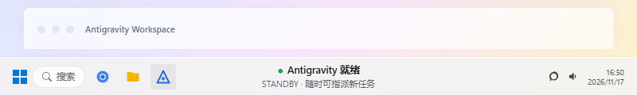

# Antigravity Taskbar Status

> Windows 任务栏嵌入式状态栏，实时展示 Google Antigravity 后台 Agent 执行进度与任务状态。



---

## 🌟 特性

- **任务栏原生嵌入**：紧贴 Windows 11 底部任务栏居中显示，完美融入系统原生视觉风格。
- **纯文本无感呈现**：无多余背景框或悬浮胶囊，背景 100% 透明，还原纯粹极简体验。
- **鼠标 100% 点击穿透**：全透明区域对鼠标事件完全穿透，不阻碍任务栏原有图标的点击与右键操作。
- **任务栏零多余图标**：采用原生无图标常驻机制（`skipTaskbar: true`），任务栏自身绝不弹出多余的进程图标。
- **像素级基线对齐**：独家状态指示灯（运行中蓝色 `✦`、等待中橙色 `⏳`、已就绪绿色 `✔`），与文本基线（Baseline）1:1 绝对对齐。
- **生命周期自动化**：依托 Antigravity 的 `SessionStart` 与 `PreInvocation` 双钩子，开启对话或触发指令时自动静默常驻，单例互斥避免多开。

---

## 🚀 快速开始

### 1. 安装插件

将本项目克隆或放置到您的 Antigravity 插件目录下：

```bash
# 默认插件目录位于用户主目录下的 .gemini/config/plugins/
cd ~/.gemini/config/plugins
git clone https://github.com/nuclearmilk/antigravity-taskbar.git
```

### 2. 安装运行时依赖

进入插件目录并安装运行时所需的 Electron 依赖：

```bash
cd antigravity-taskbar
npm install
```

### 3. 启用插件

在 Antigravity 配置文件 `~/.gemini/config/config.json` 中的 `plugins` 段加入启用配置：

```json
{
  "plugins": {
    "antigravity-taskbar": {
      "enabled": true
    }
  }
}
```

重新打开 Antigravity 或开启任意对话，任务栏正中央即可自动展示 Agent 的实时运行状态！

---

## 📁 目录结构

```text
antigravity-taskbar/
├── core/
│   ├── detector.js      # 智能探测最新的活跃会话 transcript.jsonl
│   ├── tailer.js        # 增量字节流日志监听器
│   ├── parser.js        # 解析 Agent 工具调用、思考与完成事件
│   └── index.js         # 核心事件协调器
├── desktop/
│   ├── launcher.js      # 系统级常驻单例启动器（CIM 创建独立进程，脱离父进程树）
│   └── runner.cjs       # 无边框穿透置顶的 Electron 任务栏渲染窗口
├── ui/
│   └── index.html       # 任务栏双行排版与单彩呼吸指示灯界面
├── hooks.json           # Antigravity 生命周期钩子配置（SessionStart + PreInvocation）
├── plugin.json          # Antigravity 插件元数据
└── package.json         # Node.js 项目配置与依赖说明
```

---

## 📄 开源协议

本项目采用 [MIT](LICENSE) 协议开源。
